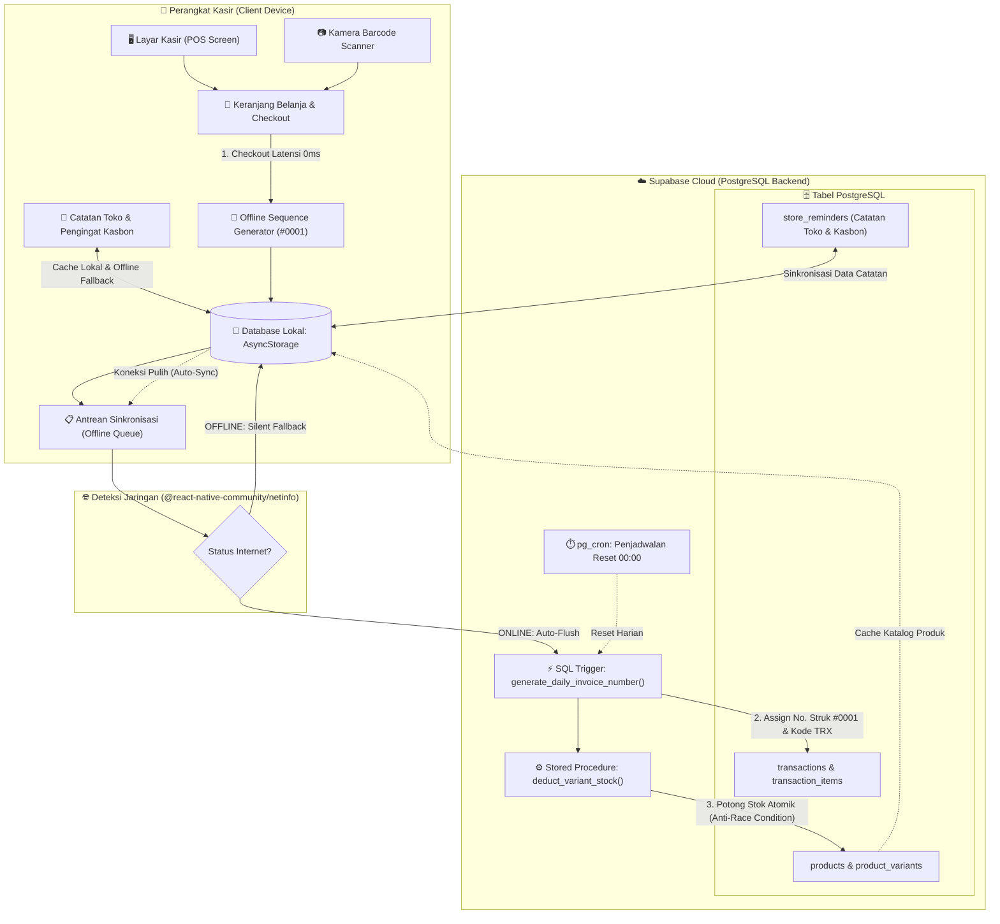
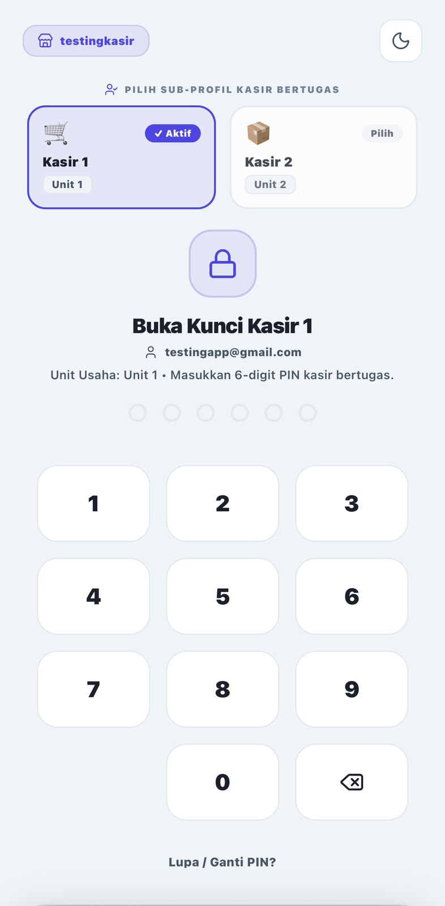
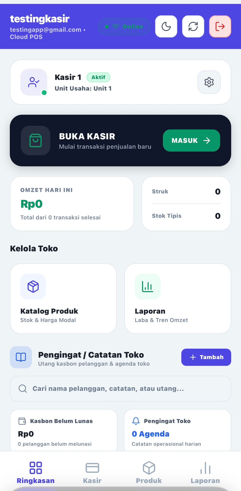
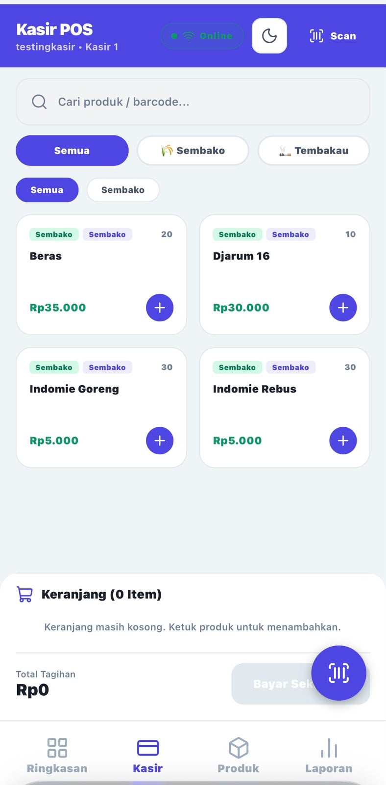
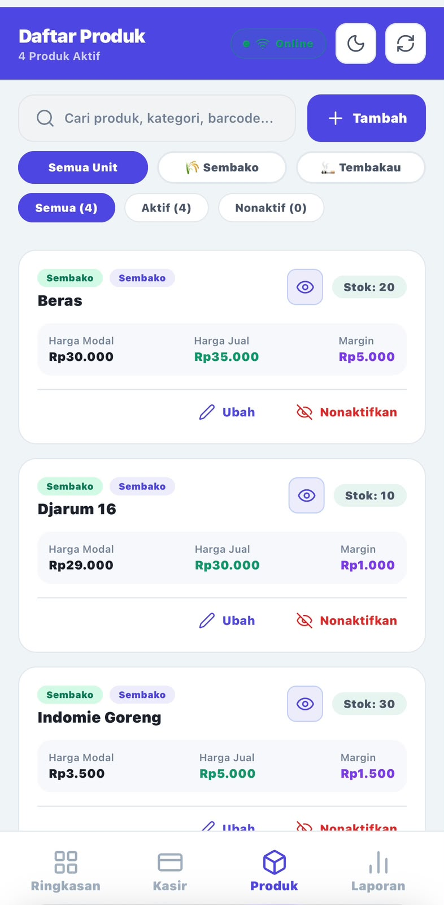
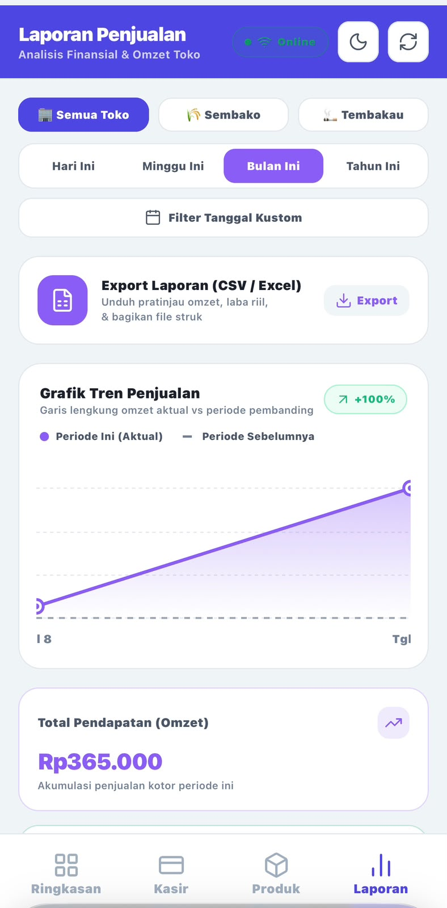
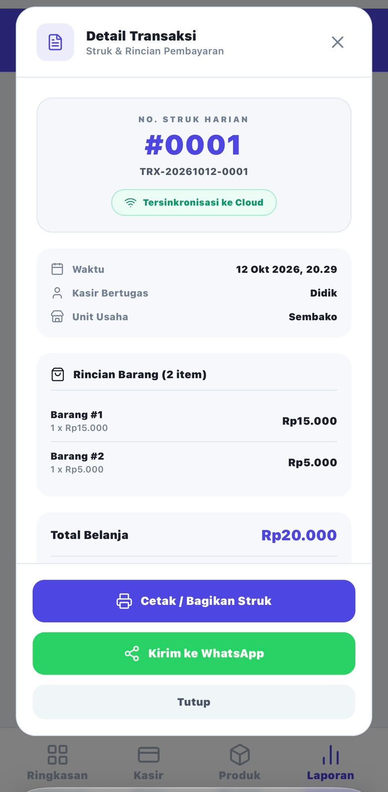

# 🏪 KasirToko POS — Modern Offline-First Cashier System

[](https://reactnative.dev/)
[](https://expo.dev/)
[](https://www.typescriptlang.org/)
[](https://supabase.com/)
[](#)
[](LICENSE)

> **KasirToko POS** adalah aplikasi Kasir & Point of Sale (POS) modern berbasis **React Native (Expo)** yang dirancang dengan filosofi **Offline-First**. Aplikasi ini memastikan transaksi penjualan di toko ritel atau UMKM tetap berjalan tanpa henti meskipun koneksi internet terputus, lalu secara otomatis menyinkronkan data transaksi dan memperbarui stok ke database cloud **Supabase** saat perangkat kembali online.

---

## 📌 Daftar Isi
- [Ikhtisar Proyek](#-ikhtisar-proyek)
- [Fitur Utama & Keunggulan](#-fitur-utama--keunggulan)
- [Riwayat Pembaruan (Changelog)](#-riwayat-pembaruan-changelog)
- [Arsitektur Offline-First & Alur Data](#-arsitektur-offline-first--alur-data)
- [Tech Stack](#-tech-stack)
- [Tangkapan Layar Aplikasi (Screenshots)](#-tangkapan-layar-aplikasi-screenshots)
- [Struktur Folder Proyek](#-struktur-folder-proyek)
- [Panduan Instalasi & Menjalankan](#-panduan-instalasi--menjalankan)
- [Konfigurasi Keamanan (.env)](#-konfigurasi-keamanan-env)
- [Skema Database Supabase](#-skema-database-supabase)
- [Praktik Terbaik Keamanan (Security Best Practices)](#-praktik-terbaik-keamanan-security-best-practices)
- [Kontribusi & Lisensi](#-kontribusi--lisensi)

---

## 📖 Ikhtisar Proyek

Dalam operasional bisnis ritel, stabilitas koneksi internet sering menjadi kendala utama saat melayani pelanggan di kasir. Ketergantungan penuh pada cloud dapat menyebabkan antrean panjang ketika jaringan internet lambat atau mati.

**KasirToko POS** memecahkan masalah ini dengan mengimplementasikan penyimpanan lokal ganda (**AsyncStorage & SQLite**) sebagai *primary transaction engine*. Setiap kasir dapat memindai barang, menambahkan ke keranjang, dan mencetak nota secara instan dengan latensi 0 ms. Transaksi disimpan dalam antrean sinkronisasi lokal dan akan di-*flush* ke server Supabase PostgreSQL melalui fungsi RPC atomik (`deduct_variant_stock`) segera setelah jaringan internet pulih.

Dilengkapi dengan **penomoran struk otomatis harian (#0001)**, **pencarian transaksi real-time**, **catatan toko & pengingat kasbon**, **format cetak thermal receipt**, serta **integrasi pengiriman nota ke WhatsApp**, KasirToko POS menghadirkan ekosistem kasir digital yang tangguh, cepat, dan nyaman digunakan di lapangan.

---

## ✨ Fitur Utama & Keunggulan

### 1. 🔐 Fresh Setup & Keamanan PIN 6-Digit
- **Onboarding Pemilik Toko (Fresh Setup)**: Alur inisialisasi awal saat aplikasi pertama kali dipasang untuk menetapkan PIN Toko 6-digit.
- **Keypad Numerik Kustom**: Tampilan tombol angka kustom yang responsif dengan efek klik instan dan visualisasi indikator PIN (titik terisi/kosong).
- **Proteksi Akses Menu**: Membatasi akses kasir ke fitur sensitif (seperti reset data, ubah PIN, dan ekspor laporan).
- **Pengaturan Ganti PIN**: Fitur verifikasi PIN lama dan validasi konfirmasi PIN baru secara aman.

### 2. 🍏 Antarmuka & Animasi Welcome ala iOS
- **Desain Modern & Ergonomis**: Mengikuti pedoman desain iOS Human Interface Guidelines dengan sudut membulat (*smooth rounded cards*), kontras tinggi, dan tata letak *safe area* yang adaptif di berbagai ukuran layar.
- **Header Sambutan Dinamis**: Ucapan selamat datang otomatis menyesuaikan waktu lokal (*Selamat Pagi*, *Selamat Siang*, *Selamat Malam*) disertai indikator nama kasir aktif dan status sinkronisasi.
- **Mikro-Animasi Halus**: Transisi layar lembut, responsif terhadap interaksi sentuhan, serta efek umpan balik visual instan.

### 3. 📈 Smooth Area Chart Laporan Interaktif
- **Visualisasi Tren Penjualan**: Dibuat menggunakan `react-native-svg` dengan kalkulasi kurva Bézier yang mulus (*smooth curved area gradient*).
- **Metrik Real-Time**: Ringkasan performa harian/mingguan mencakup **Total Omzet**, **Total Transaksi Selesai**, **Laba Kotor**, dan **Rata-rata Nilai Belanja (AOV)**.
- **Filter Periode Fleksibel**: Tombol pintas untuk menyaring rentang data: *Hari Ini*, *7 Hari Terakhir*, *30 Hari Terakhir*, atau *Semua Waktu*.
- **Analisis Produk Terlaris**: Menampilkan peringkat barang paling diminati pelanggan beserta volume unit terjual.

### 4. 📤 Ekspor Laporan (CSV & Excel-Ready)
- **Ekspor Dokumen Satu-Klik**: Mengonversi riwayat penjualan ke format CSV terstruktur yang langsung kompatibel dengan Microsoft Excel, Google Sheets, atau software akuntansi.
- **Integrasi Native Sharing**: Menggunakan `expo-file-system` dan `expo-sharing` untuk mengirim berkas laporan langsung melalui WhatsApp, Email, Telegram, Google Drive, atau download lokal di platform Web.

### 5. 🏷️ Manajemen Produk Aktif/Nonaktif & Multi-Varian
- **Toggle Status Produk**: Tombol aksi dan ikon interaktif (👁️ Mata Terbuka = Aktif, 🚫 Mata Dicoret = Nonaktif) untuk menonaktifkan produk yang sedang habis musimnya atau tidak dijual sementara waktu.
- **Daftar Kasir Tersaring Otomatis**: Produk yang berstatus nonaktif secara otomatis disembunyikan dari layar Kasir/POS untuk mencegah kesalahan input transaksi kasir, tanpa menghapus riwayat laporan masa lalu.
- **Tampilan Redup (Greyed-Out) di Manajemen**: Produk nonaktif tetap terlihat di menu manajemen dengan label penanda "Nonaktif" dan kontras visual redup (opacity 0.5) agar mudah diaktifkan kembali sewaktu-waktu.
- **Notifikasi Toast Mengambang**: Konfirmasi perubahan status muncul dalam bentuk *Toast Alert* dengan animasi *fade-in/fade-out* berdurasi 2.5 detik yang bersih dari risiko *memory leak*.
- **Multi-Varian & Barcode**: Setiap produk dapat memiliki beberapa varian (ukuran, rasa, kemasan) dengan harga, modal, stok, dan kode barcode unik masing-masing.

### 6. 📷 Barcode Scanner Terintegrasi
- Mendukung pemindaian barcode fisik melalui kamera perangkat menggunakan `expo-camera` untuk menambahkan produk ke keranjang belanja dalam hitungan detik.

### 7. 🧾 Penomoran Struk Otomatis Harian (#0001) Berbasis SQL Trigger & Cron Job
- **Format Padded 4-Digit (#0001)**: Setiap transaksi memiliki nomor struk harian yang rapi dan mudah dibaca (misal `#0001`, `#0002`, `#0003`) terpisah untuk setiap toko/pengguna.
- **PostgreSQL Trigger Atomik**: Ditenagai trigger `generate_daily_invoice_number` (`BEFORE INSERT`) pada Supabase PostgreSQL yang secara atomik mengalkulasi `invoice_seq` berikutnya dan menghasilkan format kode transaksi resmi `TRX-YYYYMMDD-0001`.
- **Reset Harian Otomatis**: Penomoran nomor struk secara otomatis kembali ke `#0001` tepat pukul 00:00 setiap pergantian hari yang terintegrasi dengan penjadwalan Supabase SQL Trigger & Cron Job (`pg_cron`).
- **Generator Urutan Offline Presisi**: Saat perangkat kasir offline, engine `syncService` dan `transactionService` secara cerdas menginspeksi antrean lokal dan transaksi hari ini untuk menetapkan nomor urut struk berikutnya tanpa tabrakan saat sinkronisasi online.

### 8. 🔍 Pencarian Transaksi Real-Time di Layar Laporan
- **Pencarian Cepat Multi-Kriteria**: Kolom pencarian instan di layar Laporan memungkinkan kasir atau manajer mencari transaksi secara real-time berdasarkan **Nomor Struk** (`#0001`), **Kode Transaksi** (`TRX-YYYYMMDD-XXXX`), ID transaksi, maupun nama pelanggan/catatan nota.
- **Indikator & Statistik Pencarian Dinamis**: Menampilkan total struk yang cocok secara instan (*live counter*) serta umpan balik visual yang informatif apabila data transaksi tidak ditemukan.
- **Pratinjau Struk Sekali Sentuh**: Mengetuk transaksi hasil pencarian akan langsung membuka dialog modal rincian nota untuk melihat daftar belanjaan, status sinkronisasi, dan aksi cetak ulang.

### 9. 📝 Catatan Toko & Pengingat Kasir (Kasbon / Utang Pelanggan)
- **Pencatatan Terpadu di Dashboard**: Fitur pengingat kasir terintegrasi langsung di layar utama untuk mencatat kasbon/utang pelanggan serta catatan operasional toko tanpa memerlukan aplikasi tambahan.
- **Filter Tab & Pencarian Cepat**: Filter navigasi instan berdasarkan kategori (*Semua*, *Kasbon Utang*, *Catatan Toko*) disertai kolom pencarian teks untuk memfilter data berdasarkan nama pelanggan atau catatan.
- **Status Pelunasan (Settled Toggle)**: Mengubah status pelunasan kasbon dengan satu ketukan, dilengkapi indikator visual tanggal jatuh tempo dan nominal utang.
- **Silent Offline Fallback**: Didukung caching lokal `AsyncStorage` dan sinkronisasi ke Supabase tabel `store_reminders` dengan fallback silent otomatis menggunakan deteksi `NetInfo` saat koneksi terputus.

### 10. 🖨️ Pengaturan Thermal Receipt, Opsi Cetak/Bagikan Nota, & Integrasi WhatsApp
- **Format Struk Thermal (58mm / 80mm)**: Generator struk teks monospaced (`generateThermalReceiptText`) yang kompatibel dengan berbagai printer thermal Bluetooth mini standar ESC/POS.
- **Cetak Ulang & Bagikan Nota Digital**: Fitur *modal preview* transaksi menyediakan tombol aksi cepat untuk membagikan atau mencetak struk menggunakan native Share dialog perangkat.
- **Integrasi Pengiriman Nota ke WhatsApp**: Membuat tautan *WhatsApp Click-to-Chat* otomatis (`generateWhatsAppReceiptUrl`) dengan pesan berformat rapi (nomor struk, rincian item, subtotal, dan identitas toko) yang dapat langsung dikirimkan ke nomor ponsel pelanggan.

### 11. 📱 Tata Letak UI Responsif dengan KeyboardAvoidingView & Scrollbar Semantik
- **Proteksi Input KeyboardAvoidingView**: Memanfaatkan `KeyboardAvoidingView` secara konsisten pada layar Laporan, Kasir, Dashboard, dan form modal untuk mencegah keyboard virtual menutupi input teks atau tombol aksi.
- **Scrollbar Semantik & Safe Area**: Konfigurasi `showsVerticalScrollIndicator={false}` dan padding bawah (*safe area bottom spacing*) yang presisi untuk memastikan konten daftar transaksi dan menu navigasi tab tidak terpotong di perangkat Android, iOS, maupun Web.

---

## 🔄 Riwayat Pembaruan (Changelog)

### Versi Terbaru (Fitur & Peningkatan Mutakhir)
- **Fitur Baru — Penomoran Struk Harian (#0001)**:
  - Implementasi PostgreSQL Trigger `generate_daily_invoice_number` di Supabase untuk penomoran otomatis `#0001` setiap hari.
  - Penjadwalan Cron Job (`pg_cron`) untuk reset dan pemeliharaan partisi data transaksi.
  - Algoritma *offline sequence generator* di `syncService` untuk kalkulasi nomor struk lokal saat tanpa internet.
- **Fitur Baru — Search Bar Transaksi Real-Time**:
  - Penambahan input pencarian di layar Laporan yang mendukung query No. Struk (#0001) dan kode TRX.
  - Menampilkan live counter dan pratinjau transaksi interaktif via `TransactionDetailModal`.
- **Fitur Baru — Modul Catatan Toko & Kasbon Pelanggan**:
  - Tabel Supabase `store_reminders` dengan kebijakan Row Level Security (RLS) terisolasi per user.
  - UI interaktif dengan tab filter, form input modal, dan toggle status lunas (*settled*).
- **Peningkatan — Thermal Receipt & WhatsApp Sharing**:
  - Template nota thermal ramah printer 58mm/80mm ESC/POS.
  - Tombol kirim struk instan ke WhatsApp pelanggan via deep link `https://wa.me/`.
- **Peningkatan UI & Ergonomi**:
  - Penambahan `KeyboardAvoidingView` di layar Laporan, Kasir, dan Dashboard.
  - Perapian padding bawah (*bottom safe area*) dan scrollbar semantik yang konsisten.

---

## 🏗️ Arsitektur Offline-First & Alur Data

Sistem dirancang untuk menjamin kelangsungan operasional kasir tanpa henti melalui arsitektur multi-layer:



### ⚙️ Alur Kerja & Ekosistem Komponen
1. **Pencatatan Transaksi Seketika (Latensi 0 ms)**: Kasir memproses checkout secara instan ke `AsyncStorage`. Jika perangkat offline, `SeqGen` menghitung nomor urut lokal sementara (`#0001`, `#0002`) dari transaksi hari ini agar kasir tetap dapat mencetak struk dengan nomor urut yang akurat.
2. **SQL Trigger & Penomoran Harian Otomatis**: Saat data transaksi di-*flush* ke Supabase, trigger `generate_daily_invoice_number()` (`BEFORE INSERT`) secara atomik menetapkan nomor struk resmi harian dan format kode transaksi `TRX-YYYYMMDD-XXXX`.
3. **Penjadwalan Reset Harian (`pg_cron`)**: Reset nomor urut struk ke `#0001` terjadi secara otomatis pada pukul 00:00 setiap pergantian hari.
4. **Pemotongan Stok Atomik (`deduct_variant_stock`)**: Menggunakan stored procedure PostgreSQL dengan kunci baris (`FOR UPDATE`) guna mencegah *race condition* atau minus stok saat banyak kasir bertransaksi bersamaan.
5. **Modul Catatan Toko & Kasbon (`store_reminders`)**: Catatan operasional dan kasbon utang pelanggan disimpan lokal dengan *silent offline fallback* dan secara otomatis disinkronkan ke tabel `store_reminders` yang terproteksi RLS per pengguna.


---

## 🛠️ Tech Stack

| Kategori | Teknologi / Pustaka | Keterangan |
| :--- | :--- | :--- |
| **Framework Utama** | [React Native 0.86](https://reactnative.dev/) | Cross-platform framework untuk iOS, Android, dan Web |
| **Tooling & Runtime** | [Expo SDK 57](https://expo.dev/) | Platform modern untuk pengembangan React Native |
| **Bahasa Pemrograman**| [TypeScript 6.0](https://www.typescriptlang.org/) | Type safety, autocompletion, dan refactoring aman |
| **Database Cloud & API**| [Supabase JS v2](https://supabase.com/) | PostgreSQL backend, RESTful API, RPC Stored Procedures & Triggers |
| **Penyimpanan Lokal** | [@react-native-async-storage/async-storage](https://react-native-async-storage.github.io/async-storage/) | Cache produk, transaksi offline, kasbon, dan kredensial PIN |
| **Navigasi** | [@react-navigation](https://reactnavigation.org/) | React Navigation v7 (Native Stack & Bottom Tabs) |
| **Grafik & Visualisasi**| [react-native-svg 15.15](https://github.com/software-mansion/react-native-svg) | Render grafik area mulus (smooth Bézier curves) & gradien |
| **Ikonografi** | [lucide-react-native](https://lucide.dev/) | Kumpulan ikon modern, konsisten, dan ringan |
| **Kamera & Barcode** | [expo-camera](https://docs.expo.dev/versions/latest/sdk/camera/) | Pemindaian barcode produk berbasis kamera perangkat |
| **Manajemen Berkas & Cetak**| [expo-file-system](https://docs.expo.dev/versions/latest/sdk/filesystem/) & [expo-sharing](https://docs.expo.dev/versions/latest/sdk/sharing/) | Pembuatan file CSV lokal, cetak struk thermal, & bagikan nota |
| **Konektivitas** | [@react-native-community/netinfo](https://github.com/react-native-netinfo/react-native-netinfo) | Pemantauan status online/offline real-time |

---

## 📱 Tangkapan Layar Aplikasi (Screenshots)

Berikut adalah antarmuka visual utama dari aplikasi **KasirToko POS**:

| 1. Keamanan & PIN Login | 2. Dashboard & Sambutan | 3. Layar Kasir / POS |
| :---: | :---: | :---: |
|  |  |  |
| *Otentikasi PIN 6-digit & Onboarding Toko* | *Ringkasan statistik & ucapan adaptif waktu* | *Katalog produk, varian, & keranjang belanja* |

| 4. Manajemen Produk | 5. Laporan & Grafik Penjualan | 6. Pencarian Struk & WhatsApp |
| :---: | :---: | :---: |
|  |  |  |
| *Toggle status produk aktif/nonaktif* | *Grafik kurva penjualan & filter periode* | *Pencarian no. struk (#0001) & share WhatsApp* |

> *Catatan: Ganti tautan placeholder di atas dengan berkas tangkapan layar asli aplikasi Anda di folder `./assets/screenshots/` sebelum publikasi akhir.*

---

## 📁 Struktur Folder Proyek

```text
KasirToko-76/
├── .env                       # Kredensial lokal (diabaikan oleh git)
├── .env.example               # Template variabel environment untuk publik
├── .gitignore                 # Konfigurasi pengabaian berkas sensitif git
├── App.tsx                    # Root entrypoint aplikasi
├── app.json                   # Konfigurasi Expo & metadata bundle
├── package.json               # Dependensi & script eksekusi
├── supabase_schema.sql        # Skrip inisialisasi tabel, relasi, trigger, & RPC Supabase
├── tsconfig.json              # Konfigurasi TypeScript compiler
└── src/
    ├── components/            # Komponen UI modular yang dapat digunakan kembali
    │   ├── Header.tsx                 # Header navigasi dengan profil & status sinkronisasi
    │   ├── NetworkBadge.tsx           # Indikator status koneksi (Online/Offline)
    │   ├── TransactionDetailModal.tsx # Pratinjau struk, cetak thermal, & share WhatsApp
    │   ├── WelcomeGreetingModal.tsx   # Modal sambutan animasi pergantian kasir
    │   └── pos/                       # Komponen spesifik layar kasir (CartDrawer, ProductGrid, dll.)
    ├── config/
    │   ├── AuthContext.tsx    # Manajemen otentikasi sesi & profil toko
    │   ├── ThemeContext.tsx   # Pengaturan tema tampilan (Light/Dark mode)
    │   └── supabase.ts        # Inisialisasi Supabase Client dengan fallback key
    ├── navigation/            # Konfigurasi rute & navigasi (Stack & Tabs)
    ├── screens/               # Layar aplikasi utama:
    │   ├── DashboardScreen.tsx # Halaman ringkasan, catatan toko, kasbon, & sambutan
    │   ├── EmailAuthScreen.tsx # Layar otentikasi login email Supabase
    │   ├── POSScreen.tsx       # Antarmuka kasir & keranjang transaksi
    │   ├── PinLoginScreen.tsx  # Otentikasi PIN 6-digit & setup toko
    │   ├── ProductScreen.tsx   # CRUD produk, multi-varian, & status toggle
    │   ├── ReportScreen.tsx    # Analisis grafik SVG, search transaksi, & ekspor CSV
    │   └── ScannerScreen.tsx   # Layar pemindaian kamera barcode
    ├── services/              # Business logic & akses data layer:
    │   ├── pinService.ts       # Manajemen otentikasi & keamanan PIN
    │   ├── productService.ts   # Operasi produk lokal & remote Supabase
    │   ├── reminderService.ts  # Manajemen catatan toko & piutang kasbon
    │   ├── syncService.ts      # Engine sinkronisasi offline-first otomatis & kalkulator struk
    │   └── transactionService.ts # Pencatatan transaksi, generator struk thermal, & WhatsApp URL
    └── types/                 # Definisi tipe TypeScript & skema database
```

---

## 🚀 Panduan Instalasi & Menjalankan

Ikuti langkah-langkah di bawah ini untuk menjalankan proyek ini di lingkungan lokal Anda:

### 1. Prasyarat Sistem
- **Node.js**: Versi LTS (disarankan v18 atau v20 ke atas)
- **Manajer Paket**: `npm`, `yarn`, atau `bun`
- **Expo Go App**: Terinstal di ponsel fisik Anda (Android / iOS) melalui Play Store atau App Store, atau menggunakan Android Studio Emulator / Xcode Simulator.

### 2. Kloning Repositori
```bash
git clone https://github.com/NarisHafidz/KasirToko-76.git
cd KasirToko-76
```

### 3. Instal Dependensi
```bash
npm install
```

### 4. Konfigurasi Environment (`.env`)
Salin file template `.env.example` menjadi `.env`:
```bash
# Untuk Linux / macOS / Git Bash:
cp .env.example .env

# Untuk Windows (Command Prompt / PowerShell):
copy .env.example .env
```
Buka file `.env` dan masukkan kredensial URL dan Anon Key proyek Supabase Anda:
```env
EXPO_PUBLIC_SUPABASE_URL=https://your-project-id.supabase.co
EXPO_PUBLIC_SUPABASE_ANON_KEY=your_supabase_anon_key_here
```

### 5. Setup Database Supabase
1. Masuk ke [Supabase Dashboard](https://supabase.com/dashboard) dan buat proyek baru.
2. Masuk ke menu **SQL Editor**.
3. Buka file `supabase_schema.sql` dari root repositori ini, salin seluruh kodenya, lalu tempelkan ke SQL Editor Supabase.
4. Klik **Run** untuk membuat tabel (`products`, `product_variants`, `transactions`, `transaction_items`, `store_reminders`), indeks, trigger penomoran struk harian (`generate_daily_invoice_number`), dan fungsi RPC pemotong stok (`deduct_variant_stock`).

### 6. Jalankan Server Pengembangan (Metro Bundler)
```bash
# Menjalankan Expo CLI interaktif
npm start

# Atau langsung membuka versi Web browser
npm run web

# Atau membuka di emulator Android
npm run android

# Atau membuka di simulator iOS (khusus macOS)
npm run ios
```

Pindai QR Code yang muncul di terminal menggunakan aplikasi **Expo Go** pada perangkat ponsel Anda.

---

## 🔒 Konfigurasi Keamanan (.env)

Keamanan kredensial adalah prioritas utama dalam proyek publik:

1. **Aturan `.gitignore`**:
   Seluruh variasi berkas `.env` telah didaftarkan dalam `.gitignore` sehingga kredensial rahasia tidak akan pernah terdorong (*pushed*) ke repositori publik:
   ```gitignore
   # environment variables & credentials
   .env
   .env.*
   .env*.local
   !.env.example
   ```

2. **Supabase Client Key**:
   Aplikasi kasir ini hanya menggunakan **Supabase ANON KEY / Publishable Key**. Kunci ini aman untuk sisi client karena Supabase menerapkan proteksi **Row Level Security (RLS)** pada level database PostgreSQL.

   > [!CAUTION]
   > **JANGAN PERNAH** menggunakan atau menyematkan **Service Role Key** ke dalam aplikasi client React Native / Expo. Service Role Key melewati seluruh batasan RLS dan hanya boleh digunakan di backend server terisolasi.

---

## 🗄️ Skema Database Supabase

Proyek ini menggunakan model relasional normalisasi dengan integritas referensial:

- **`products`**: Menyimpan data induk produk, kategori, unit bisnis, dan flag status (`is_active: boolean`).
- **`product_variants`**: Menyimpan varian produk (nama varian, harga jual, harga modal, barcode, dan kuantitas stok). Terhubung via `ON DELETE CASCADE` ke tabel `products`.
- **`transactions`**: Menyimpan header transaksi penjualan (kode transaksi unik, nomor urut struk harian `invoice_seq`, kasir, total nominal, metode pembayaran, nomor WhatsApp pelanggan, `transaction_date`, dan timestamp).
- **`transaction_items`**: Menyimpan rincian item tiap transaksi beserta varian yang dibeli, harga modal saat penjualan, harga satuan saat transaksi, dan subtotal.
- **`store_reminders`**: Menyimpan catatan kasir dan piutang/utang pelanggan (kasbon) dengan tipe `debt` atau `reminder`, nama pelanggan, nominal, tenggat waktu, dan status pelunasan (`is_settled`).
- **Trigger `trg_generate_daily_invoice`**: Menghasilkan urutan struk harian (`invoice_seq`) `#0001` secara otomatis dan mereset nomor setiap pergantian hari (00:00).
- **RPC `deduct_variant_stock(p_variant_id, p_qty)`**: Fungsi SQL atomik untuk memotong kuantitas stok varian di server tanpa risiko *race condition*.

---

## 🛡️ Praktik Terbaik Keamanan (Security Best Practices)

- **Isolasi Variabel Lingkungan**: Menggunakan prefix `EXPO_PUBLIC_` secara selektif hanya untuk konfigurasi yang aman dikonsumsi oleh client.
- **Proteksi Hashing PIN**: PIN kasir diverifikasi menggunakan komparasi terproteksi di penyimpanan lokal tanpa mengirimkan teks polos (*plaintext*) ke jaringan yang tidak terenkripsi.
- **Validasi Data Transaksi**: Perhitungan total belanja dan subtotal dilakukan secara independen di sisi logika layanan (*service layer*) untuk mencegah manipulasi data harga di UI.
- **Memory Leak Protection**: Komponen notifikasi dan listener jaringan selalu membersihkan timer (`clearTimeout`) dan subscription listener saat siklus hidup komponen dilepas (*unmount*).

---

## 📄 Kontribusi & Lisensi

Proyek ini didistribusikan di bawah lisensi **MIT**. Anda bebas menggunakan, memodifikasi, dan mendistribusikan kode ini untuk keperluan komersial maupun non-komersial.

```text
MIT License - Hak Cipta (c) 2026 Naris Hafidz Fahrezi
```

---

<p align="center">
  Dibuat dengan ❤️ oleh <b>Naris Hafidz Fahrezi</b> untuk kemajuan UMKM dan Ekosistem Retail Modern.
</p>
